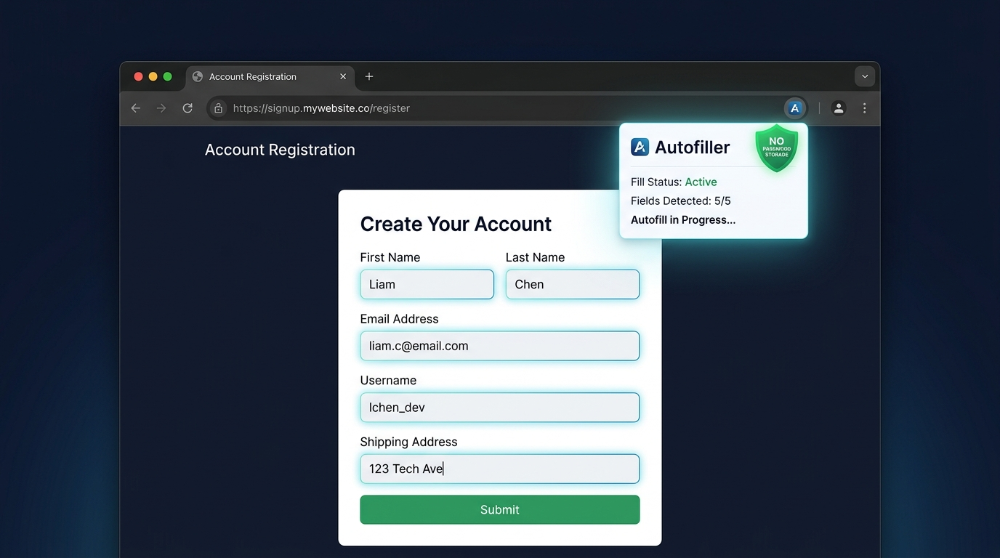

# Autofiller

Autofiller is a Chrome extension that turns repetitive form filling into a simple, repeatable workflow.

Instead of retyping the same details across sign-ups, applications, and checkout forms, Autofiller detects fields, applies your saved profile, and lets you review before submitting.

<td align="center" width="53%" style="text-align: center;">
  <div align="center">
    
  </div>
  <br>
</td>


## 🔄 How It Works

<div align="center">

<table>
  <tr>
    <td align="center" width="23%">
      <br><br>
      <sub><strong>🔍 1. Detect</strong><br>Identifies form fields automatically</sub>
    </td>
    <td align="center" width="23%">
      <br><br>
      <sub><strong>⚡ 2. Autofill</strong><br>Fills supported fields instantly</sub>
    </td>
    <td align="center" width="23%">
      <br><br>
      <sub><strong>⚙️ 3. Manage</strong><br>Control your saved profile data</sub>
    </td>
  </tr>
</table>

</div>

## Features

- Detects common form fields automatically
- Saves reusable profile details
- Fills forms with one click
- Supports name, email, phone, address, and custom fields
- Manage profiles from the options page
- Works locally in the browser
- Does not store passwords

## Installation

1. Download or clone this repository.
2. Open Chrome and go to `chrome://extensions`.
3. Turn on **Developer mode**.
4. Click **Load unpacked**.
5. Select the `Autofiller` folder.

## Project Structure

```text
Autofiller/
├── README.md
├── assets/
│   ├── icon16.png
│   ├── icon32.png
│   ├── icon48.png
│   └── icon128.png
├── background/
│   └── service-worker.js
├── content/
│   └── content.js
├── options/
│   ├── options.css
│   ├── options.html
│   └── options.js
├── popup/
│   ├── popup.css
│   ├── popup.html
│   └── popup.js
├── screenshot/
│   ├── form-detect.png
│   ├── autofill.png
│   └── image.png
├── autofiller_project_document.pdf
└── manifest.json
```

## Privacy

Autofiller does not store passwords. Form data is handled locally in your browser and is used only to autofill forms at your request.

## Author

Created by [@rootadbc](https://github.com/rootadbc)
