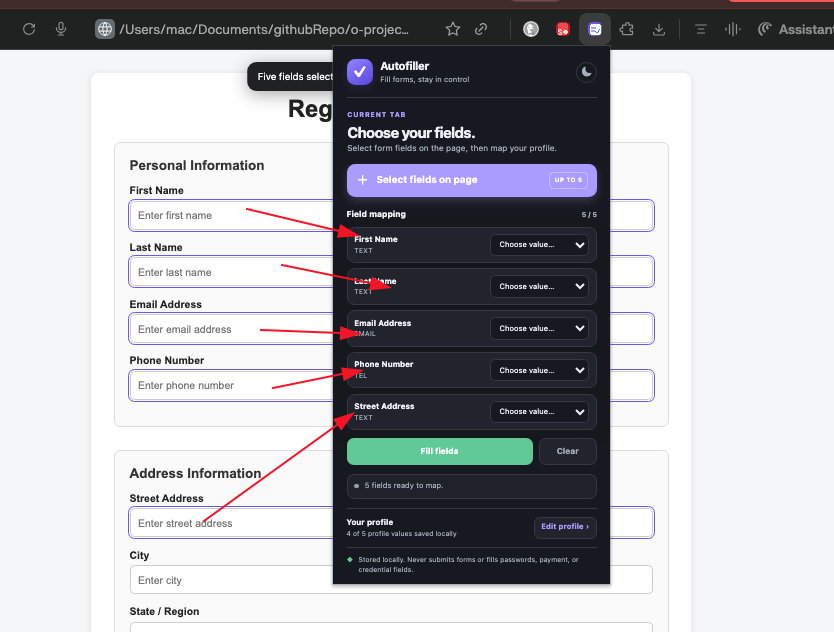
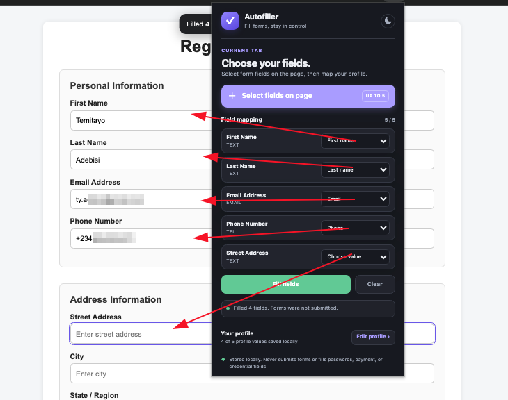

# Autofiller

Autofiller is a Chrome extension that helps you fill repetitive online forms quickly and consistently.

It saves you from retyping the same details across job applications, sign-up forms, and other routine web forms—without storing your passwords.

## Screenshots

<table>
  <tr>
    <td align="center" valign="top">
      <br>
      <sub><strong>Form Detection</strong></sub>
    </td>
    <td align="center" valign="middle">
      <br>
      <sub><strong>Autofill</strong></sub>
    </td>
    <td align="center" valign="bottom">
      <br>
      <sub><strong>Extension</strong></sub>
    </td>
  </tr>
</table>

## Features

- Detect common form fields automatically
- Fill saved profile details with one click
- Support for name, email, phone, address, and custom fields
- Manage saved profiles from the options page
- Works entirely in the browser
- No password storage

## How It Works

1. Open a form.
2. Click the Autofiller icon.
3. Choose a saved profile.
4. Review the suggested values.
5. Fill the form.

## Installation

1. Download or clone this repository.
2. Open Chrome and go to `chrome://extensions`.
3. Turn on **Developer mode**.
4. Click **Load unpacked**.
5. Select the `Autofiller` folder.

## Project Structure

```text
Autofiller/
├── README.md
├── assets/
│   ├── icon16.png
│   ├── icon32.png
│   ├── icon48.png
│   └── icon128.png
├── background/
│   └── service-worker.js
├── content/
│   └── content.js
├── options/
│   ├── options.css
│   ├── options.html
│   └── options.js
├── popup/
│   ├── popup.css
│   ├── popup.html
│   └── popup.js
├── screenshot/
│   ├── form-detect.png
│   ├── autofill.png
│   └── image.png
├── autofiller_project_document.pdf
└── manifest.json
```

## Privacy

Autofiller does not store passwords. Form data is handled locally in your browser and is used only to autofill forms at your request.

## Author

Created by [@rootadbc](https://github.com/rootadbc)
