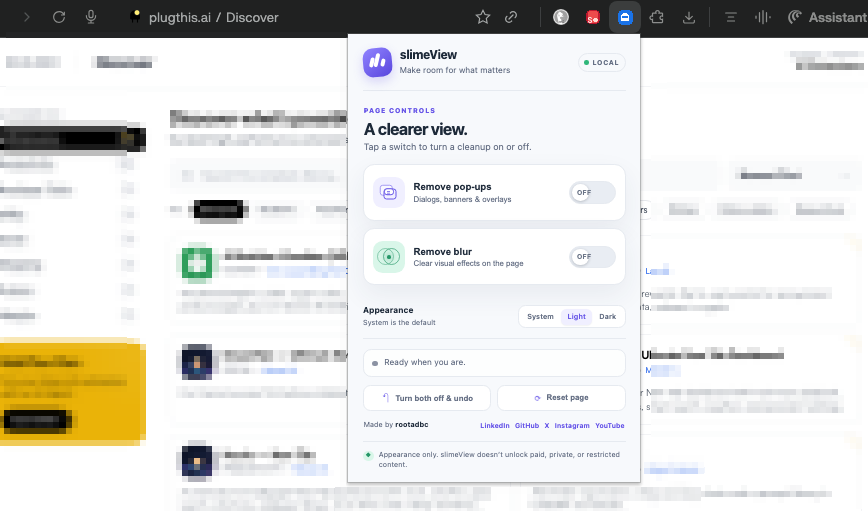
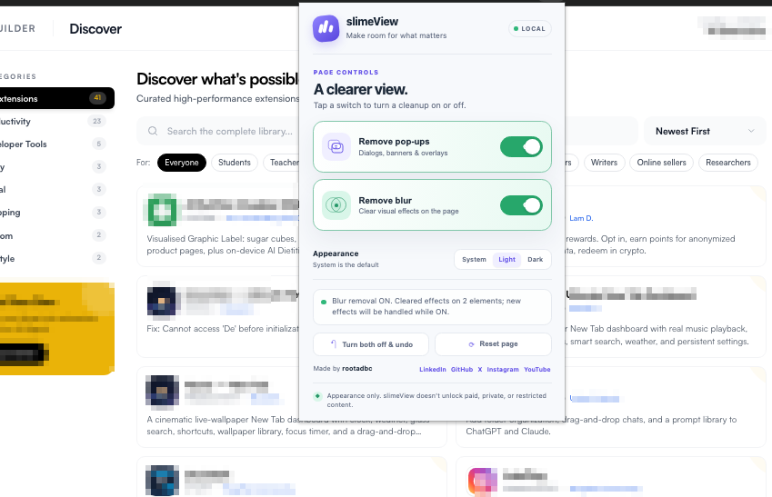

# SlimeView

SlimeView4 is a Chrome extension that cleans up distracting web pages by blocking common pop-ups and removing blur effects.

It helps you focus on the content you actually want to see—without manually closing overlays or fighting blurred text.

<td align="center" width="53%" style="text-align: center;">
  <div align="center">
    
  </div>
  <br>
</td>


## 🔄 How It Works
<table>
  <tr>
    <td align="center" valign="top">
      <br>
      <sub><strong>1. Block Pop-ups</strong></sub>
    </td>
    <td align="center" valign="bottom">
      <br>
      <sub><strong>2. Remove Blur</strong></sub>
    </td>
  </tr>
</table>

## Features

- Blocks common pop-ups, overlays, and dialogs
- Removes CSS blur effects from page content
- Enables text selection where possible
- Simple popup interface
- Lightweight and privacy-focused
- Works entirely in the browser

## How It Works

1. Open any webpage.
2. Click the SlimeView4 icon.
3. Choose **Block pop-ups** or **Remove blur**.
4. The page is cleaned instantly.

## Installation

1. Download or clone this repository.
2. Open Chrome and go to `chrome://extensions`.
3. Turn on **Developer mode**.
4. Click **Load unpacked**.
5. Select the `slimeView` folder.

## Project Structure

```text
slimeView/
├── README.md
├── background.js
├── content.js
├── popup.html
├── popup.css
├── popup.js
├── manifest.json
├── icons/
│   ├── icon16.png
│   ├── icon32.png
│   ├── icon48.png
│   └── icon128.png
└── screenshot/
    ├── image.png
    └── image1.png
```

## Important

Use SlimeView only on pages you own or have permission to modify. It is intended to improve your own browsing experience, not to bypass paywalls, authentication, or access controls.

## Privacy

SlimeView does not collect or send your browsing data. It only interacts with the current page when you use its features.

## Author

Created by [@rootadbc](https://github.com/rootadbc)
